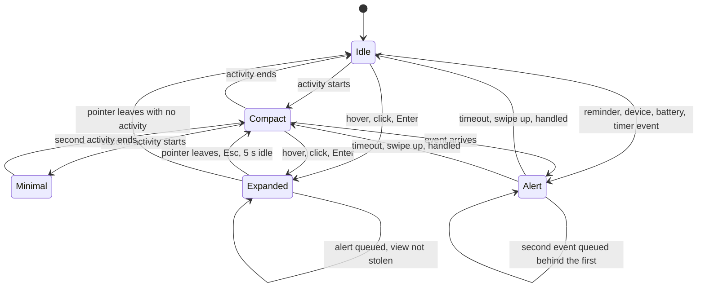

# Phase 0, design spec

Assumption: Phase 0 re-baselines the design against this master prompt. The working app in `app/` stays as the reference build, and nothing in Phases 1 to 6 changes until this spec is approved.

Skills: the unslop skill is loaded and its plain-writing rules apply to UI copy. The emil-design-eng and Apple skills are not installed here, so sections 4 to 6 of the master prompt are the source of truth for motion and interaction. Conflict order: unslop on look, Apple on interaction, Emil on timing.

## State diagram

The machine has four user-visible states. The code names in `app/src/core/stateMachine.ts` map to them in the table below the diagram.

| Master prompt state | Code view | Size (CSS px, 100% scale) | Notes |
| --- | --- | --- | --- |
| Idle pill | `collapsed` | 132 x 32 | Clock and status dot. `minimal` in code is a Compact variant at 312 x 36 that splits a second activity off as a bubble. |
| Compact | `compact` | 252 x 36 | One live activity. Readable in under a second. |
| Expanded | `expanded`, then `full` | 392 x 196, then 420 x 336 in the reference build. Prototype: 420 x 228 | `expanded` is one activity with controls. `full` is the paged hub. Page state is separate from island state and survives collapse. Owner feedback at Phase 0: 336 px tall is too long. The paged size to build to is 420 x 228, as prototyped, and trimming the reference build to match is Phase 1 work. |
| Alert | `peek` | 310 x 60 | One row, self-dismisses, never takes focus. Uses the `pop` spring. |

Every event is valid in every state (`stateMachine.ts:20`). An alert that arrives while Expanded is queued and does not pull the view away (`stateMachine.ts:54`). That rule is kept.

## Design tokens

Source of truth in code: `app/src/styles/tokens.css` and `app/src/styles/app.css:5`. Hex values live in `tokens.css` only. The contrast script (`scripts/contrast.mjs`) checks the palette.

Color:

| Token | Value | Use |
| --- | --- | --- |
| `--notch-surface` | #1D1D1F | Island body, near-black |
| `--notch-surface-deep` | #1A1A1A | One tone step lighter/darker for tiles and rows inside the island |
| `--notch-surface-light`, `--notch-on-dark` | #F5F5F7 | Primary text on dark, light theme surface |
| `--notch-text-secondary` | #AAAAAA | Detail text, page dots at rest |
| `--notch-divider` | #E0E0E0 | Light theme dividers |
| `--notch-action` | #007AFF | Single primary action or selected item per state. Today circle in the week strip |
| `--notch-agent` | #6A0DAD | Rare flat accent, fills only, never text on dark |
| `--notch-danger` | #FF4500 | Battery at 10% or lower, destructive confirm only |

Two deviations are already in the code and stay, with reasons. `--notch-action-text` #66AFFF exists because #007AFF at small text sizes fails 4.5:1 on #1D1D1F. `--notch-success` #33E07A is used for connected and done states. Both are checked by the contrast script. No other colors may be added without updating that script.

Type:

- One UI face: SF Pro when a licensed copy is installed on the PC, otherwise the bundled Inter variable face (SIL OFL) — the closest open-source match to Apple's macOS typeface — then Segoe UI Variable, Segoe UI and system-ui (`--notch-font`). OnlySans is still honoured when installed, but it is commercial (Daria Cohen / Contemporary Type) and is not bundled.
- Numbers use the same face with `font-variant-numeric: tabular-nums`. Timers, dates, battery percentages and lyric timing never use proportional figures.
- Four sizes only: 11px caption and time, 12px detail, 13px row title, 15px page heading. The prototype and spec use these. Parts of the current app use other sizes, and bringing them back to four is Phase 1 cleanup, not Phase 0 work.
- Weight carries hierarchy: 700 for titles, 400 for detail.

Spacing and radius:

- 4px grid. Tokens: `--notch-space-1` 4px, `-2` 8px, `-3` 16px, `-4` 24px.
- Island: flat top, bottom radius grows with the state. 16px in Idle, 18px in Compact, 20px in Alert, 24px in Expanded. Nested radii follow outer minus padding. Icon tiles are 9px at 34px, summary tiles 12px.
- Inner surfaces are one tone step from the island. No borders, no shadows, no glass, no decorative gradients. The one exception in the current code is a radial-gradient used as a shape mask for the concave top corners of the island (`app.css:43`). It renders as a flat edge, not a color gradient. It stays, and the prototype draws the same flat result without a gradient.

Motion (named values):

| Token | Value | Use |
| --- | --- | --- |
| `--ease-out` | cubic-bezier(0.23, 1, 0.32, 1) | Every eased move. No ease-in anywhere |
| `--dur-fast` | 120ms | Hover, press. Buttons scale to 0.97 |
| `--dur-view` | 180ms | Content cross-fade with a 6px upward settle |
| `settle` spring | stiffness 420, damping 38 | Utilitarian moves: collapse, resize, page settle. No visible bounce |
| `pop` spring | stiffness 300, damping 20 | Alert arrival only. Slight overshoot is allowed here and nowhere else |
| page dots | 260ms, same ease-out | Active dot widens to an 18px pill in sync with the page |
| battery ring | 600ms ease-out, first appearance only | Later updates change in place |
| lyric line change | 350ms ease-out | The one high-frequency exception. Ease between lines, never jump |

Source: `app/src/hooks/useSpringSize.ts:20`, `app/src/styles/app.css:6`. Reduced motion swaps travel for a 120ms cross-fade (`app.css:319`). Springs carry velocity across retargets, so a state change mid-morph does not jump. Exit is the same spring with a nearer target, so it reads faster than entry.

## Layout of each state

Idle pill. Flush with the top edge, centered. Clock in tabular numerals and one status dot. Nothing else. Minimal pill mode trims this to the dot.

Compact. Left: module glyph or equalizer bars while media plays. Center: one line, title then source, truncated with an ellipsis. Right: time or percentage in tabular numerals. One activity only.

Alert. One row for every kind of event: a 34px rounded-square tile in the module color, a bold title, one gray detail line that truncates, and a right-aligned gray time ("now", "12 min", "1h"). Reminder alerts add Done and Snooze and stay until handled. Other alerts hold about 4 seconds and leave. Swipe up dismisses. The alert never takes focus.

Expanded, paged. Pages in this order by default: Media, Today, Devices, Shelf, Timer, plus Reminders and Water in the current build. The user can reorder or hide pages in Settings, and the last page is remembered per context. Page dots sit at the bottom center, active dot is an 18px white pill, hidden when one page is left. Arrow keys, wheel, swipe and the arrow buttons change pages.

Media page. Art at 44px, title and artist, a scrub bar you drag, transport controls, shuffle and repeat, and the lyric block under it. Current lyric line at full contrast, neighbours dimmer but still at 4.5:1 or better.

Today page. Left column: "Today" and up to 3 upcoming rows from reminders, to-dos and timers, same row shape as alerts. Right column: date and time in tabular numerals, a 7-day strip with today in a solid #007AFF circle, and a summary tile one tone step lighter with a status dot, a bold count line and a gray "Next" line. It reads app data only. No calendar, no Windows notifications. When the "Show text previews" setting is off, rows show "Reminder due" instead of the reminder text, in alerts and here.

Devices page. One row per connected device: type tile, name, battery ring with the percentage in the middle when the device reports one, charging mark when the device reports that. No ring when nothing is reported.

Shelf, Timer, Reminders pages. Shelf parks file references, not copies. Timer is the focus timer with custom durations. Reminders has quick add with natural phrasing and the water preset.

What's new card. One card per version: title, at most three bullets, each with a small colored dot, plain words, no marketing copy.

## App icon concepts

Section 2 asks for a rounded-square icon that works from 16 to 256px in light and dark. Three original concepts were drawn for Phase 0 and rendered at 256, 64, 32 and 16px in `prototype/icon-concepts.png`. None uses a cat or any Nusa asset.

- A. Rounded square in #1D1D1F with a flat pill cut into the top edge and one #007AFF dot under it. Reads at 16px as "a notch on a tile". This is the recommendation.
- B. Rounded square with the live-activity bars from the current icon. Fails at 16px: the bars merge into one block.
- C. Rounded square with a bold N. Rejected in spec: it reads as a letter logo, not as the product shape.

Gap closed in the full run-through that followed Phase 0 approval: the app icon is now Concept A (`app/src-tauri/icons/icon.png` and `icon.ico`), a rounded square with the pill cut into the top and one blue dot. The island itself keeps the pill shape, which is a different thing from the app icon.

## Feasibility table

Every row names the mechanism, the risk, and the fallback shown when the data cannot be read.

| Module | Windows API or mechanism | Risk | Fallback |
| --- | --- | --- | --- |
| Media | Global System Media Transport Controls (GSMTC) via the `windows` crate, `Media_Control` feature | Some players publish incomplete sessions. Ads and missing duration are common | Show title and transport only. Hide the scrub bar when duration is unknown. Never invent progress |
| Lyrics | LRCLIB over HTTPS (`/api/get` then `/api/search`), closest duration wins, results a few seconds off are dropped | Network is the only one the app uses. Wrong-track matches, malformed LRC, slow replies | Local cache first. Designed states for loading, no synced lyrics, instrumental and offline. A reply for a track that already ended is discarded. Lyrics switch in Settings kills all network access |
| Bluetooth cards | Bluetooth LE GATT battery service plus classic device properties via `windows` crate (`Devices_Bluetooth`) | Many devices report no battery. Classic and BLE can double-report one device | Card without a ring. De-duplicate by device id. Alerts at 20% and 10% only, once per discharge, stored so a restart does not repeat them |
| Reminders | Local store (SQLite via rusqlite, DPAPI for sensitive fields), clock injected behind an interface | Sleep, time zone and daylight saving shifts, manual clock changes | Fire once on wake. Recurrence computed in local time. Ambiguous text ("9") asks, never guesses |
| Today | Same local stores as Reminders, to-dos, timers | Midnight rollover while the page is open | Recompute at midnight and on page entry. Week strip handles month and year edges with plain date math, unit tested |
| File shelf | Tauri drag and drop, file paths stored as references | Deleted, moved, locked files, disconnected drives | Row shows the missing or locked state with Remove. No copies are made, so nothing goes stale silently |
| Focus timer, to-do | Local store, same injected clock | Sleep during a session | Deadline stored as an absolute time. On wake the timer shows the true remaining time |
| Quiet rules | Fullscreen detection per monitor, Focus Assist state, display change events | Borderless games and browser video look like normal windows to simple checks | Conservative check plus a per-app pause. A maximized normal window never hides the island |
| Settings | Local JSON with atomic write (temp file, then replace), versioned schema | Corrupt file after a power cut | Keep the previous file. Bad data loads defaults and says so in Diagnostics |

## Stack decision (5 lines)

Tauri 2 with a Rust core and a React and TypeScript front end, already decided in `docs/ADR-001.md` and shipped. It uses the system WebView2, so there is no bundled Chromium and the installer is 3.68 MB. Idle cost stays near zero because rendering pauses when nothing changes, and the Rust side owns the Win32 window styles (no-activate, tool window, click-through regions). Springs and ease-out curves from the web side map to a requestAnimationFrame spring in `useSpringSize.ts`, which holds 60fps or better on the test machine because only width, height, radius, transform and opacity move. The fallback named in the ADR still holds: if frame budgets fail on real hardware, the TypeScript core ports to WinUI without changes.

The installer is the Tauri NSIS bundle, per-user, no admin. This is the one place the build departs from the master prompt's default of Inno Setup: the stack favors NSIS, the wizard already carries the licence page, icon, publisher metadata and uninstall registration, and switching tools would add a second installer to test for no user-visible gain.

## Phase 0 prototype

Judge it as a desktop app, not a web page. Run `powershell -ExecutionPolicy Bypass -File prototype\launch-native.ps1`: it starts the native Tauri window (`app/src-tauri/target/release/notch.exe`, or `npm run tauri dev` when no binary exists), and the island sits at the top-center of the screen. Verified on this machine, screenshot in `test-artifacts/phase0-native.png`. The browser file `prototype/phase0.html` is only the motion and layout source for the same states, kept for quick screenshot passes. Do not judge the feel from Edge.

What to judge:

- The morph. Hover, click and the state buttons retarget one spring. Change your mind mid-flight and it keeps its velocity.
- The alert. Four alert buttons, one row shape, auto-dismiss, swipe up to dismiss, `pop` spring only here.
- The pages. Drag, wheel, arrow keys. Dots widen in sync. Media and Today pages use the section 2 layout, including the week strip and summary tile.
- Reduced motion toggle swaps travel for a cross-fade.

Sample data is marked as sample data in the page. The real island reads live sources.

## Tests run

- `npm test` in `app/`: 17 files, 79 tests, all pass.
- `node scripts/contrast.mjs`: all checks pass. Lowest ratios: secondary text on dark 7.24:1, danger text on dark 4.89:1, primary action on dark 4.19:1 (large and icon use only).
- Prototype screenshots in headless Edge (settled, reduced motion on): Compact, Alert, Media page and Today page in `test-artifacts/phase0-*.png`. The alert detail line truncates with an ellipsis. The Today rows show full titles after the layout fix in the phase report.
- Owner feedback round: Expanded height cut from 300 to 228 px in the prototype and re-screenshotted. Media and Today pages fit with no clipped rows and no overlap with the page dots. Page area above the island shrank from 46vh to a fixed 330 px.
- Native launch: `app/src-tauri/target/release/notch.exe` started as a desktop window, sat flush at the top-center of the screen over other apps (screenshot `test-artifacts/phase0-native.png`), and closed cleanly. It did not open in a browser.
- Icon concepts rendered at 256, 64, 32 and 16px in `prototype/icon-concepts.png`.
- No Rust or installer changes in this phase, so no build or install test was run.

## Self-review

In the phase report. Before, after and why against the unslop, Apple, Emil and section 2 checklists, including two prototype fixes made during this phase: the Today row layout and the page track.

## Needs manual verification

- Alert and morph feel on a real 120Hz or 144Hz display. Headless screenshots cannot show frame pacing.
- The icon concepts at 16px on a real taskbar, light and dark.
- Whether the Expanded two-step (392 x 196 controls, then pages) matches how you picture "Expanded" in section 1, or whether pages should open directly. The paged size itself is now fixed at 420 x 228 after your "too long" note.
